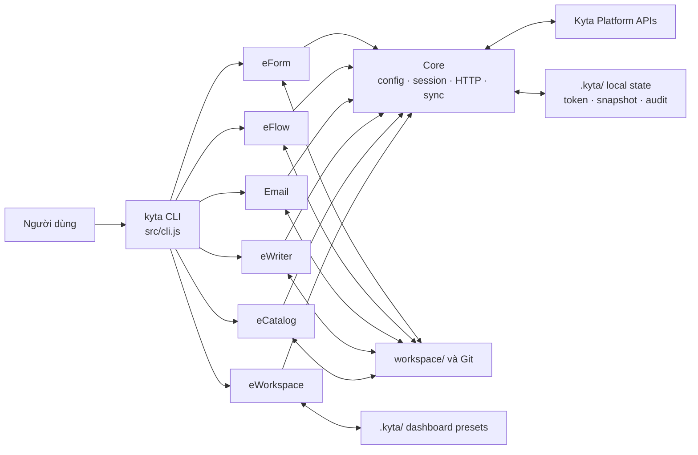

# Kyta Form Script Registry

Công cụ dòng lệnh để quản lý code eForm, quy trình eFlow, mẫu email và tài liệu bản in eWriter trên Kyta Platform. Project giúp kéo tài nguyên từ server về Git, chỉnh sửa tại local, xem thay đổi và đẩy lại lên đúng khách hàng/môi trường.

> Các API trong project được xác minh bằng request thực tế và ghi lại trong [`docs/api.md`](docs/api.md), [`docs/eflow-schema.md`](docs/eflow-schema.md), [`docs/ewriter-schema.md`](docs/ewriter-schema.md) và [`docs/eworkspace-schema.md`](docs/eworkspace-schema.md). API và cấu trúc dữ liệu của Kyta có thể khác giữa phiên bản hoặc tenant; hãy dùng tài liệu này như ghi chú vận hành của project.

## Mục lục

- [Project làm gì](#project-làm-gì)
- [Cài đặt và cấu hình](#cài-đặt-và-cấu-hình)
- [Cấu trúc thư mục](#cấu-trúc-thư-mục)
- [Cách đồng bộ hoạt động](#cách-đồng-bộ-hoạt-động)
- [Các lệnh CLI](#các-lệnh-cli)
- [Luồng làm việc thường gặp](#luồng-làm-việc-thường-gặp)
- [Rào chắn và lưu ý vận hành](#rào-chắn-và-lưu-ý-vận-hành)
- [Phát triển project](#phát-triển-project)
- [Tài liệu liên quan](#tài-liệu-liên-quan)

## Project làm gì

Project cung cấp một CLI tên `kyta` với sáu phân hệ:

| Phân hệ | Tài nguyên local | Tác vụ chính |
|---|---|---|
| `eform` | Code động, custom UI và cấu hình field của form | List, pull, push, field (label/required/readonly/datasource...), status, diff, kiểm tra môi trường và tạo registry |
| `eflow` | `jsonXml` của quy trình | List, pull, push; xem node; implementer, eNotify, điều kiện dây, gán biểu mẫu, kế thừa dữ liệu |
| `email` | Nội dung HTML và metadata của mẫu mail | List, pull, push, status và tạo bản sao mẫu |
| `ewriter` | Tài liệu bản in `.docx` + biến trộn | List, pull/push cả file `.docx`, đổi trạng thái, clone; gán biến từ eForm; đối chiếu/sửa/chèn placeholder; preview tự kiểm merge |
| `ecatalog` | Danh mục dữ liệu và bản ghi | Quản lý danh mục, field, cấu hình hiển thị và dữ liệu |
| `eworkspace` | Dashboard và danh sách người dùng | Tra ID user theo email; thêm dashboard theo user; gỡ toàn bộ dashboard của user; quản lý dashboard preset theo môi trường |

Mỗi tài nguyên được đặt dưới `workspace/<customer>/<env>/<module>/`. Git lưu nội dung có thể review và lịch sử thay đổi. Cấu hình tài khoản cùng trạng thái phiên làm việc lưu riêng trên máy.



## Cài đặt và cấu hình

### Yêu cầu

- Node.js 18 trở lên
- Git
- Tài khoản Kyta có quyền truy cập đúng customer và môi trường

### Cài dependencies

```bash
npm ci
```

Có thể gọi CLI trực tiếp từ thư mục project:

```bash
node bin/kyta.js --help
```

Để gọi bằng `kyta` từ terminal:

```bash
npm link
kyta --help
```

### Khai báo host

Host môi trường chung và host riêng theo khách hàng được khai trong [`config/kyta.json`](config/kyta.json).

Khi tìm host cho một dịch vụ, project áp dụng thứ tự:

1. Host khai riêng tại `customers["<customer>@<env>"]`.
2. Host khai tại `envs["<env>"]`.
3. Với `eflow`, `ewriter`, `ecatalog`, `eworkspace` và `account`, nếu chưa khai riêng thì thử suy từ host eForm bằng tiền tố tương ứng.

Host `portal` được dùng để chuẩn hoá đường dẫn trong email. Nếu tenant dùng domain khác quy tắc suy luận, hãy khai host tường minh. Không đặt username, password, token hoặc cookie trong `kyta.json`.

eWorkspace dùng host/base path riêng theo gateway; các mapping dev, sandbox, demo và prod đã được khai trong `config/kyta.json`. Nếu tenant dùng gateway khác, khai `eworkspace` tại `envs` hoặc `customers["<customer>@<env>"]`.

### Khai báo credentials

Tạo file local từ mẫu:

```bash
cp config/credentials.example.json config/credentials.local.json
```

Khai tài khoản theo khóa `<customer>@<env>` hoặc theo khóa `<env>` nếu dùng chung một tài khoản trong môi trường đó. Password có thể để trực tiếp trong file local hoặc tham chiếu đến biến môi trường bằng `passwordEnv`:

```json
{
  "sabeco@prod": {
    "username": "user@example.com",
    "passwordEnv": "KYTA_SABECO_PROD_PW"
  }
}
```

Ví dụ đặt biến môi trường trong shell:

```bash
export KYTA_SABECO_PROD_PW='...'
```

`config/credentials.local.json` đã được gitignore. Không commit credentials hoặc chia sẻ file này lên Git.

Đăng nhập và kiểm tra host:

```bash
kyta login sabeco uat
kyta login sabeco uat --force  # bỏ qua cache phiên hiện có và đăng nhập lại
```

Phiên được lấy từ dịch vụ account/eaccount. Server có thể trả cookie hoặc bearer token; request `401` sẽ tự đăng nhập lại và thử lại một lần. Thời hạn request mặc định là 60 giây, có thể đổi bằng `KYTA_TIMEOUT_MS`.

## Cấu trúc thư mục

```text
bin/kyta.js                    # executable của CLI
src/
  cli.js                       # dispatch lệnh chung và lệnh theo phân hệ
  core/                        # config, session, HTTP, filesystem, sync, audit
  commands/                    # login, log
  eform/                       # API, cây form, registry, guard và lệnh eForm
  eflow/                       # API, đọc modeler/đồ thị node và lệnh eFlow
  email/                       # API, xử lý template và lệnh email
  ewriter/                     # API, dựng biến từ jsonForm, đọc .docx và lệnh eWriter
  ecatalog/                    # API danh mục, field, cấu hình hiển thị và dữ liệu
  eworkspace/                  # API dashboard, tra user và quản lý preset
config/
  kyta.json                    # host và cấu hình xác thực không chứa bí mật
  credentials.example.json     # mẫu credentials
  credentials.local.json       # credentials trên máy, không commit
workspace/
  <customer>/
    README.md                  # trang chủ khách: nghiệp vụ, luồng, trạng thái, việc tồn — đọc trước khi làm
    specs/                     # đặc tả KHÔNG theo env: forms/<formCode>.yaml, flows/, selectors/; _raw/ = file gốc BA
    docs/                      # tài liệu riêng khách (API đối tác, bàn giao...)
    tools/                     # script riêng khách (chạy từ gốc repo)
    <env>/<module>/            # tài nguyên đã pull hoặc chuẩn bị push; env = khoá "envs" trong config/kyta.json
  registry.json                # registry form được sinh tự động
.kyta/                         # cache phiên, snapshot eForm và audit local
docs/                          # tài liệu nền tảng dùng chung: API, schema, node template, playbook kỹ thuật
test/                          # test logic chạy offline
.githooks/pre-commit           # guard eForm khi pre-commit được bật
```

Ví dụ cấu trúc form:

```text
workspace/<customer>/<env>/eform/<nhóm>/<tên-form>/
  .meta.json
  code/
    main.js
  ui/
    table_advance-1/
      index.html
      style.css
      script.js
  fields.json          # cấu hình mọi field: label, required, readonly, display, dropdown datasource...
```

`fields.json` giữ nguyên vẹn cấu hình từng field trong `jsonForm` (trừ danh tính `id`/`hashid`/`type` và
custom UI đã tách ra `ui/`). Xem [`docs/eform-fields-schema.md`](docs/eform-fields-schema.md) để biết
property theo từng loại field. Sửa nhanh bằng `kyta eform field set`, hoặc chỉnh tay rồi `push --fields-only`.
`kyta eform field delete` xoá hẳn field khỏi form trên server (khó hoàn tác) — tự chặn nếu field còn bị
tham chiếu ở jsonForm, `code/`/`ui/` (id đầy đủ, hashid, key ngắn `ref("type-N")`), điều kiện ẩn/hiện hoặc code
form khác cùng env (cần `--force` để bỏ qua), nên chạy `--dry-run` xem trước.
`push --fields-only` (và `field set --push`) chỉ đẩy field đã sửa cục bộ so với snapshot lúc pull; field server
đổi mà local không đụng thì giữ bản server, cả hai cùng sửa → báo xung đột. Key trùng giữa form cha và form con
nhúng → phải chỉ định bằng hashid. Mọi lần ghi jsonForm đều backup bản server vào `.kyta/backups/eform/` và tự
đồng bộ `variableArr`.

Nền tảng để hiểu/dựng field và code động: [`docs/eform-node-templates/`](docs/eform-node-templates/) (node mẫu
đầy đủ từng loại field + biến thể formula/datasource) và [`docs/eform-code-api.md`](docs/eform-code-api.md)
(kho hàm runtime của code editor: `getFieldValue`, `changeFieldValue`, `bindFieldChangeEvent`...).

Form con (`child_form`) nhúng **bản sao** field của form start vào `child_form.components`; sửa form start
KHÔNG tự cập nhật (trên UI phải "chọn lại form start"). `kyta eform childform list` phát hiện bản sao đã cũ,
`childform refresh` copy lại field mới nhất từ form start — thay cho thao tác chọn lại thủ công. Refresh giữ
hashid + readonly/disabled của bản nhúng (`--keep value,...` giữ thêm) và chặn nếu bản nhúng có field form start
không còn (form cha drift) trừ khi `--force`. Refresh/propagate đồng bộ cả điều kiện ẩn/hiện nhúng
(`childFormConfig.childFormCondition_value` = `jsonFormCondition` của form start, so theo nội dung); form cha cố ý giữ
điều kiện riêng thì khai `"keepCondition": true` trong `embed.overrides.json`.

Cấu hình điều kiện ẩn/hiện field lưu ở `form.jsonFormCondition`. `kyta eform condition` quản lý các luật
"KHI field-nguồn thoả điều kiện THÌ show/hide field khác" (operator: equal/un_equal/empty/un_empty/include).

Quy trình eFlow và mẫu email có một thư mục riêng cho mỗi tài nguyên:

```text
workspace/<customer>/<env>/eflow/<tên-quy-trình>/
  .meta.json
  flow.json

workspace/<customer>/<env>/email/<tên-mẫu>/
  .meta.json
  content.html
```

`.meta.json` giữ ID, customer/env và thông tin mapping của tài nguyên. Với eFlow/email, metadata còn giữ hash nội dung lần pull gần nhất để phát hiện local đã sửa. Với eForm, metadata ánh xạ tên file local sang key/order mà API yêu cầu và mô tả custom UI; cấu hình field nằm ở `fields.json`; snapshot hash code/UI/fields của eForm được lưu riêng trong `.kyta/snapshots.json`. `workspace/registry.json` được tạo từ cây form để tra `formId` về customer, env và đường dẫn; không nên chỉnh tay, hãy chạy `kyta eform registry` để tạo lại.

`.kyta/` là trạng thái riêng của máy, không đưa vào Git. Trong đó có cache token/cookie, snapshot hash eForm phục vụ status/diff guard và audit log `audit.jsonl`.
Danh sách dashboard preset eWorkspace lưu tại `.kyta/eworkspace-dashboards.json`, tách theo môi trường và không ghi lên server.

## Cách đồng bộ hoạt động

### eForm

Code động và custom UI được lưu bằng hai API khác nhau:

- Code động: `GET/PUT /forms/{formId}/code`.
- Định nghĩa form chứa custom UI: `GET/PUT /owner/form`.

Khi pull, CLI tải code động và cố lấy thêm định nghĩa form. Nếu form đang bị khoá khiến không tải được định nghĩa, code động vẫn được pull; UI local đã có sẽ được giữ lại. Code được ghi thành các file `.js`; custom UI thành `index.html`, `style.css`, `script.js` trong `ui/<field>/`.

Khi push, CLI xác định đích từ `targetFormId`, formId nhận diện trong code hoặc metadata; sau đó kiểm tra registry và so sánh trạng thái với snapshot. Có thể chỉ đẩy code (`--code-only`) hoặc UI (`--ui-only`). UI được vá vào định nghĩa mới nhất của form, để giữ những field không thuộc custom UI local.

Code API là **full-replace**: các key không có trong payload sẽ bị xoá trên server. Tên file local và key server được nối với nhau qua `.meta.json`.

### eFlow và email

eFlow lưu nội dung `jsonXml` trong `flow.json`; email lưu `content` trong `content.html`. Khi push, CLI lấy bản mới nhất từ server, chỉ vá field nội dung và metadata được yêu cầu bằng `--with-meta`, rồi gửi lại object. Trước khi ghi, `guardDrift` so sánh hash lần pull với server để phát hiện trường hợp người khác đã sửa server.

Khi push email, các URL portal trong nội dung được chuẩn hoá theo host portal của môi trường đích. Nếu nội dung được đổi để chuẩn hoá, sau khi push thành công CLI cập nhật file local tương ứng.

Các lệnh `eflow impl` và `eflow notify` gọi API riêng để quản lý người thực hiện và cấu hình thông báo. Những cấu hình này hiện chưa nằm trong luồng pull/push `flow.json` thông thường.

### `status`, `diff` và snapshot

- `eform status`, `eflow status` và `email status` so sánh local với mốc hash local từ lần pull/push; các lệnh status không tự tải bản mới từ server.
- `eform diff` gọi server và hiển thị diff giữa bản local với bản hiện tại trên Kyta.
- `--force` bỏ qua kiểm tra drift khi push; chỉ sử dụng khi đã xem xét khác biệt và chủ động chấp nhận ghi đè.
- Pull/push thành công cập nhật metadata hoặc snapshot để các lần status sau nhận ra trạng thái mới.

## Các lệnh CLI

Xem danh sách và cú pháp đầy đủ:

```bash
kyta --help
kyta eform
kyta eflow
kyta email
kyta ewriter
kyta ecatalog
kyta eworkspace
```

### Lệnh chung

```bash
kyta login <customer> <env> [--force]
kyta log [<thư-mục-tài-nguyên>] [--limit N]
kyta where <thư mục | formId | formId_key | hashid | id catalog | id luồng | tên> [--customer c --env e] [--json]
```

`where` tra đồ thị workspace (offline): form → form con nhúng / form cha nhúng nó / form khác dùng token / luồng /
eWriter / catalog; field → nơi định nghĩa, bản nhúng (cờ hashid riêng), code/luồng/eWriter tham chiếu. Field nhúng chỉ
xác định được chủ khi `fields.json` có `id` (pull từ 26/10/2026 trở đi).

`log` đọc lịch sử thao tác đã được ghi vào audit local, mới nhất trước. Audit không phải nhật ký đầy đủ của mọi request đọc hoặc mọi lỗi.

### eForm

```bash
kyta eform list <customer> <env> [--grep "chuỗi"]
kyta eform pull <customer> <env> <formId...> [--group "Tên nhóm"]
kyta eform pull <customer> <env> --all [--include-new] [--group "Tên nhóm"]
kyta eform push <form-folder> [--dry-run] [--code-only] [--ui-only] [--fields-only] [--yes-prod] [--force]
kyta eform field list   <form-folder>
kyta eform field get    <form-folder> <key|hashid>
kyta eform field set    <form-folder> <key|hashid> [--label ...] [--required true|false] [--readonly ...] [--display ...] [--set path=value] [--push]
kyta eform field add    <form-folder> <type> [--label ...] [--required ...] [--readonly ...] [--hidden] [--after <key>] [--set path=value] [--dry-run]
kyta eform field group  <form-folder> <key1,key2,...> [--as columns|row|splitter] [--hidden] [--dry-run]
kyta eform field move   <form-folder> <key> --into <container-key|hashid> [--after <key>] [--dry-run]
kyta eform field delete <form-folder> <key|hashid> [--dry-run] [--force] [--yes-prod]
kyta eform childform list    <form-folder>
kyta eform childform refresh <form-folder> [--keep value,display,...] [--dry-run] [--force] [--yes-prod]
kyta eform propagate <form-con-folder> [--only <regex>] [--keep ...] [--dry-run] [--force] [--yes-prod]
kyta eform lib list|extract|sync <customer> <env> [<TÊN>|--all] [--from <form>] [--dry-run] [--push]
kyta eform lint [<path>...] [--errors-only]
kyta eform run <form-folder> [--fixture f.json] [--set field=json]... [--change field=json]... [--time ms] [--cascade]
kyta eform condition list    <form-folder>
kyta eform condition add     <form-folder> <fieldNguồn> <operator> [value] [--show k1,k2] [--hide k3] [--dry-run]
kyta eform condition remove  <form-folder> <conditionId> [--dry-run]
kyta eform condition toggle  <form-folder> <conditionId> [--off] [--dry-run]
kyta eform status [<path>]
kyta eform diff <form-folder> [--code | --ui | --fields]
kyta eform detect <file | form-folder>
kyta eform guard [<path>...]
kyta eform registry
```

`propagate` lan bản server của form con sang mọi form cha nhúng nó (danh sách từ `where`), mỗi form cha như
`childform refresh`; chỉnh riêng cố định của form cha khai ở `<form-cha>/embed.overrides.json`
(`{ "<childFormId>": { "keep": [...], "set": { "<id field>": { "value": "OK" } }, "keepCondition": false } }`).

`lib`: khối code dùng chung đánh dấu `// ===== [TÊN] ... // ===== [/TÊN]` trong `code/*.js` và `ui/<field>/script.js`
có nguồn gốc ở `workspace/<customer>/<env>/lib/<TÊN>.js`; `{{@k}}` trong lib thay bằng `@params {"k":...}` trên dòng
marker từng form. `lib sync` ghi lại thân khối vào mọi form (local), `--push` đẩy luôn.

`lint` kiểm tĩnh: token `{{formId_key}}` trỏ key không có ở cả form đang xét lẫn form đích (tham chiếu chết), marker
khối hỏng, khối lệch lib. `push` tự chạy lint (chỉ báo) và sau khi ghi thì đọc lại server để verify khớp local.

`run` chạy code động offline với runtime giả lập (đồng hồ ảo, fetch theo fixture, DOM rỗng) và in trace các lời gọi
`changeFieldValue`/`setDisplayField`/`showToast`/lỗi. Hành vi runtime thật (sự kiện khi đổi bằng code, thời điểm
`onInitData`) chưa đối chiếu — `--cascade` để bật bắn change event khi code đổi field.

`pull` định vị thư mục theo `.meta.json` (`formId`/`targetFormId`), không theo vân tay code; không ghi đè thư mục đang khai formId khác (`--force` để bỏ chặn). `--all` mặc định chỉ làm mới form đã có trong workspace, thêm `--include-new` để kéo cả form server chưa track. `pull --into <form-folder>` kéo một form cụ thể vào thư mục đã chọn; chỉ nhận một ID và không kết hợp với `--all`.

`detect` tìm formId trong code và tra registry. `guard` kiểm tra form có đúng customer/env/đích push không; nếu không truyền path, nó kiểm tra file eForm đang staged. `registry` dựng lại bảng tra từ workspace.

### eFlow

```bash
kyta eflow list <customer> <env> [--grep "chuỗi"]
kyta eflow pull <customer> <env> <modelerId...>
kyta eflow pull <customer> <env> --all
kyta eflow push <flow-folder> [--dry-run] [--with-meta] [--force] [--status active|unpublic]
kyta eflow status [<customer> [<env>]]
kyta eflow nodes <customer> <env> <quy-trình> [--grep "chuỗi"] [--all]
kyta eflow roles <customer> <env> [--grep "chuỗi"]
```

Tham chiếu modeler có thể là ID, `keyValue` hoặc tên; tham chiếu node có thể là SID hoặc tên. Nếu tên khớp nhiều mục, CLI báo các lựa chọn thay vì tự chọn.

Quản lý người thực hiện:

```bash
kyta eflow impl list <customer> <env> <quy-trình> <node>
kyta eflow impl add <customer> <env> <quy-trình> <node> --type role --role "Tên role"
kyta eflow impl add <customer> <env> <quy-trình> <node> --type creator --dry-run
kyta eflow impl rm <customer> <env> <implementerId> [--dry-run]
kyta eflow impl clear <customer> <env> <quy-trình> <node> [--dry-run]
```

CLI hiện hỗ trợ các kiểu `role`, `creator`, `directManager`, `management`, `step` cho `impl add`. Xem toàn bộ option bằng `kyta eflow impl`.

Quản lý eNotify:

```bash
kyta eflow notify list-all <customer> <env> <quy-trình> [--grep "chuỗi"]
kyta eflow notify list <customer> <env> <quy-trình> <node>
kyta eflow notify templates <customer> <env> [--grep "chuỗi"]
kyta eflow notify fields <customer> <env> <quy-trình> --form "Tên form"
kyta eflow notify add <customer> <env> <quy-trình> <node> --template "Tên mẫu" --recv-role "Tên role" [--dry-run]
kyta eflow notify set <customer> <env> <quy-trình> <node> [--config-id ID] [--dry-run]
kyta eflow notify rm <customer> <env> <configId> [--dry-run]
```

`notify add` hỗ trợ người nhận dạng user, role, step, hoặc field của form; option thời điểm gửi và option đầy đủ được in bằng `kyta eflow notify`.

```bash
kyta eflow cond list   <customer> <env> <quy-trình> [--node X] [--all] [--raw] [--local]
kyta eflow cond fields <customer> <env> <quy-trình> [--node X|start] [--grep "chuỗi"]
kyta eflow cond set    <customer> <env> <quy-trình> <sid dây | "Nguồn->Đích"> --when '"Nhãn" == "Giá trị" or Node::"Nhãn" == "x"' | --clear [--dry-run]
kyta eflow inherit list <customer> <env> <quy-trình> [<node>]
kyta eflow inherit auto <customer> <env> <quy-trình> <node đích> [--from <node|start>] [--replace] [--dry-run]
kyta eflow inherit copy <customer> <env> <quy-trình> <node mẫu> <node đích> [--dry-run]
kyta eflow form list <customer> <env> <quy-trình> [<node>]
kyta eflow form set  <customer> <env> <quy-trình> <node> --form <id|mã|tên> | --latest [--dry-run]
```

`cond set` sinh cả JUEL (`staticValue`) lẫn Blockly XML giống editor, chỉ ghi `flow.json` local — đẩy bằng `eflow push` (lưu ý rủi ro jsonXml S3/mã hoá 2 lần ở BMW). `inherit auto` khớp field theo hashid rồi nhãn+kiểu và ghi `variables-configs`. `form set` đổi form khác sẽ xoá kế thừa của node (giống UI) → dựng lại bằng `inherit`. Chi tiết: [`docs/eflow-schema.md`](docs/eflow-schema.md) mục 3.2/3.3/3.5.

### Email

```bash
kyta email list <customer> <env> [--grep "chuỗi"]
kyta email pull <customer> <env> <templateId...>
kyta email pull <customer> <env> --all
kyta email push <email-folder> [--dry-run] [--with-meta] [--force]
kyta email status [<customer> [<env>]]
kyta email clone <srcId> <customer> <env> --name "Tên mới"
```

`email clone` tạo mẫu mới trên server với trạng thái draft rồi pull mẫu vừa tạo về local; đây là lệnh có ghi lên server.

### eWriter

```bash
kyta ewriter list <customer> <env> [--grep "chuỗi"]
kyta ewriter pull <customer> <env> <id|tên...> | --all [--grep "chuỗi"] [--no-docx]
kyta ewriter push <folder> [--dry-run] [--force]
kyta ewriter changed [<customer> [<env>]]
kyta ewriter status <customer> <env> <id|tên> <nháp|sẵn sàng|cuối cùng> [--dry-run]
kyta ewriter clone <customer> <env> <id|tên nguồn> --name "Tên mới"
kyta ewriter vars forms <customer> <env> [--grep "chuỗi"]
kyta ewriter vars list  <customer> <env> <id|tên tài liệu>
kyta ewriter vars apply <customer> <env> <id|tên tài liệu> --form <formId|tên form> [--replace] [--dry-run]
kyta ewriter docx info|check|fix|rename|field|table|strip-comments <thư mục tài liệu | file .docx> [...]
kyta ewriter preview <customer> <env> <id|tên> | <thư mục tài liệu>  [--form ..] [--values v.json] [--out x.pdf|x.docx]
```

`ewriter pull` lưu mỗi tài liệu thành thư mục gồm `.meta.json`, `variables.json` và `variable-data.json`. `vars apply` kéo field nhập liệu của một eForm (đọc `jsonForm`) thành biến trộn và lưu vào tài liệu qua `variable-data/save-all`, đồng thời gắn `eformId`; mặc định chỉ thêm field mới, `--replace` đồng bộ lại toàn bộ (sinh code mới). `status` đổi trạng thái tài liệu (nháp/sẵn sàng/cuối cùng) qua `updateResource`. `pull` kéo kèm file bản in: `template.docx` (gói gốc) + `document.xml` (dàn mỗi đoạn/bảng/dòng/ô một dòng — sửa trực tiếp file này); `push` đóng gói lại, chặn nếu file trên server đổi từ lần pull, upload rồi tải lại đối chiếu. `docx check` đối chiếu placeholder `Nhãn (hashid)` với field form (mặc định `eformId`; chữ ký nằm ở form duyệt → thêm vào `--form a,b`), `fix` tự sửa nhãn/hashid lệch; `field`/`table` chèn MERGEFIELD sau chữ neo / bảng in (DOCVARIABLE + `col_N`, cột lấy từ form) sau đoạn chứa neo, giữ font của neo. `preview` render trên server với giá trị mẫu `[hashid]` rồi báo placeholder không được điền (dùng file trên server — push trước). Xem [`docs/ewriter-schema.md`](docs/ewriter-schema.md) để hiểu mô hình biến và cú pháp điều kiện trong docx.

### eWorkspace

- `kyta eworkspace users <customer> <env> resolve <email...> [--emails-file <file>]`
- `kyta eworkspace dashboard <customer> <env> add <dashboard-id...> --user <id,email> [--user <id,email>...]`
- `kyta eworkspace dashboard <customer> <env> add --preset --email <email> [--emails-file <file>]`
- `kyta eworkspace dashboard <customer> <env> delete --user <id,email> [--users-file <file>] [--yes]`
- `kyta eworkspace preset <env> list|add|rename|rm|reset`

`--users-file` nhận CSV hai cột `id,email`; `--emails-file` nhận một email mỗi dòng. Lệnh thêm chạy tối đa 6 request đồng thời, mỗi cặp dashboard-user một request. Email không tra được sẽ dừng thao tác. Lệnh `delete` gỡ **tất cả** dashboard của các user truyền vào. Lệnh ghi cần `--yes`; môi trường `prod` cần thêm `--yes-prod`. Dùng `--dry-run` để xem kế hoạch. Xem endpoint và quy tắc xác thực tại [`docs/eworkspace-schema.md`](docs/eworkspace-schema.md).


## Luồng làm việc thường gặp

### 1. Xem và kéo tài nguyên

```bash
kyta login saigoncoop sandbox
kyta eform list saigoncoop sandbox --grep "Tờ trình"
kyta eform pull saigoncoop sandbox <formId>
```

Quy trình và mẫu email dùng cú pháp tương tự với `kyta eflow list/pull` và `kyta email list/pull`.

### 2. Chỉnh sửa và kiểm tra local

Sửa các file trong thư mục tài nguyên. Sau đó kiểm tra trạng thái và diff:

```bash
kyta eform status workspace/saigoncoop/sandbox/eform/<nhóm>/<form>
kyta eform diff workspace/saigoncoop/sandbox/eform/<nhóm>/<form>
```

`eform diff` cần đăng nhập và truy cập server. Với eFlow và email, xem thay đổi local bằng `status`; có thể review nội dung bằng Git diff.

### 3. Xem trước và push

```bash
kyta eform push "workspace/saigoncoop/sandbox/eform/<nhóm>/<form>" --dry-run
kyta eform push "workspace/saigoncoop/sandbox/eform/<nhóm>/<form>"
```

Đối với production, eForm yêu cầu `--yes-prod`. Với eFlow có thể chọn `--status unpublic` để lưu trạng thái chưa publish. Xem mục [Rào chắn và lưu ý vận hành](#rào-chắn-và-lưu-ý-vận-hành) trước mọi thao tác ghi.

`--dry-run` vẫn đăng nhập và đọc dữ liệu cần thiết từ server để dựng kế hoạch, nhưng không gửi thay đổi lên server.

### 4. Commit thay đổi

```bash
kyta eform registry
git status
git diff
git add workspace/
git commit -m "Cập nhật tài nguyên Kyta"
```

Có thể bật pre-commit hook của repo bằng:

```bash
git config core.hooksPath .githooks
```

Hook gọi `kyta eform guard` để phát hiện các form staged có dấu hiệu lệch môi trường. Hook cần Node.js và registry/workspace local đầy đủ.

## Rào chắn và lưu ý vận hành

- **eForm code là full-replace.** Thiếu key trong payload có thể xoá code tương ứng trên server. Kiểm tra file local và metadata trước khi push.
- **`--force` bỏ qua phát hiện thay đổi server từ lần pull.** Không dùng chỉ để vượt lỗi; hãy xem diff và xác nhận nội dung cần ghi.
- **Production cần được kiểm soát cẩn thận.** Hiện eForm push yêu cầu `--yes-prod`; eFlow và email chưa có cờ xác nhận production tương đương.
- **eFlow push mặc định `--status active`.** Theo ghi chú API của project, `active` là trạng thái publish. Nếu cần lưu quy trình chưa public, chỉ định `--status unpublic`.
- **`eform push` hiện xử lý lỗi `check-edit` theo kiểu cảnh báo rồi tiếp tục.** Hãy đảm bảo form không đang bị mở/khoá trên modeler; request ghi cuối cùng vẫn có thể bị server từ chối.
- **Các lệnh thao tác eFlow trực tiếp lên server.** `impl clear`, `impl rm`, `notify rm`, `notify add/set` thay đổi cấu hình ngay sau khi chạy; dùng `--dry-run` ở các lệnh hỗ trợ trước khi xác nhận.
- **Status là so sánh với mốc local.** Nó không chứng minh server hiện vẫn giữ đúng nội dung đó; dùng `eform diff` để đối chiếu eForm trực tiếp với server.
- **Workspace có thể chứa business logic và dữ liệu nhạy cảm của khách hàng.** Tuân theo phân quyền repo và chính sách lưu trữ dữ liệu của tổ chức.
- Chỉ file `config/credentials.local.json` và thư mục `.kyta/` được loại khỏi Git theo `.gitignore`; trước khi thêm file bí mật mới, kiểm tra chúng đã được ignore.

## Phát triển project

Project dùng CommonJS, Node.js built-in `fetch` và TypeScript `checkJs` để kiểm tra JavaScript. Không cần build step để chạy CLI.

```bash
npm test
npm run typecheck
npm run guard
npm run guard -- workspace/<customer>/<env>/eform
```

- `npm test`: chạy các test offline bằng Node test runner; không gọi API Kyta.
- `npm run typecheck`: chạy TypeScript ở chế độ kiểm tra JavaScript nghiêm ngặt, không sinh output.
- `npm run guard`: kiểm tra các file eForm đang staged, giống pre-commit hook.
- `npm run guard -- <path>`: kiểm tra form hoặc nhánh workspace được chỉ định, kể cả khi chưa staged.

Khi thêm một lệnh mới:

1. Tạo command trong `src/<module>/commands/`.
2. Đăng ký command và mô tả trong `src/<module>/index.js`.
3. Đặt gọi API trong `src/<module>/api.js`; dùng `src/core/http.js` và `src/core/session.js` cho request/xác thực.
4. Đưa logic dùng chung vào `src/core/` hoặc domain tương ứng thay vì nhân bản giữa command.
5. Bổ sung test offline cho phần parse, mapping payload, diff hoặc guard có thể kiểm tra không cần server.
6. Cập nhật README/tài liệu API nếu thay đổi cú pháp hoặc phát hiện hành vi API mới.

Các endpoint và schema đã khảo sát:

- [`docs/ewriter-eform-integration-playbook.md`](docs/ewriter-eform-integration-playbook.md): Sổ tay tích hợp eForm ↔ eWriter (MailMerge, đồng bộ hashid, cấu hình nút xem bản in, test preview E2E).
- [`docs/ewriter-schema.md`](docs/ewriter-schema.md): API eWriter và cấu trúc tài liệu docx.
- [`docs/api.md`](docs/api.md): host, auth, endpoint eForm/eFlow/email và các khác biệt payload.
- [`docs/eflow-schema.md`](docs/eflow-schema.md): cấu trúc `jsonXml`, stencil và cấu hình eFlow đã reverse-engineer.
- [`docs/postman/`](docs/postman/): Postman collection và environment mẫu.

