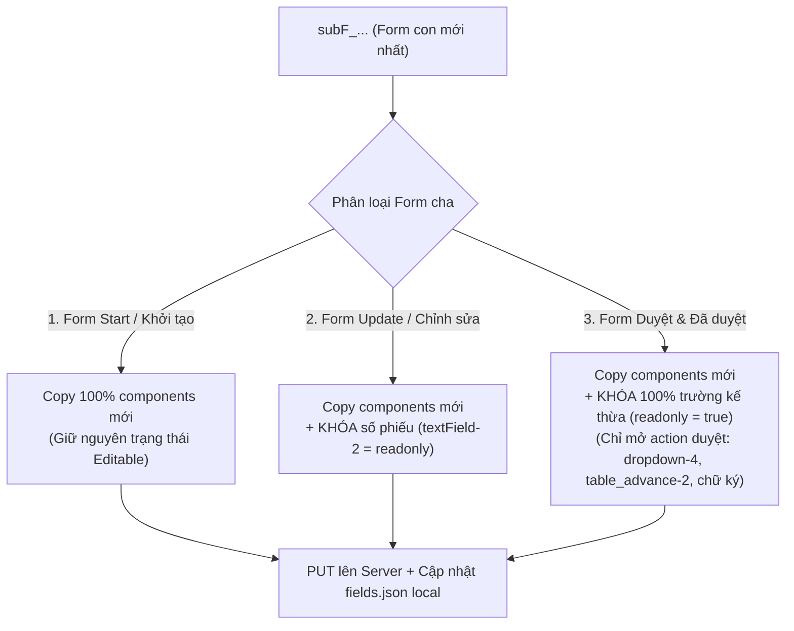

# Playbook: Cơ chế Subform (Child Form) & Mẹo Đồng Bộ Nhanh trên Kyta Platform

Tài liệu này giải thích bản chất kiến trúc của thành phần **Form con (`child_form`)** trên nền tảng Kyta Eform, lý do tại sao phải đồng bộ các form cha khi sửa subform, và kịch bản tự động hóa giúp xử lý nhanh trong vài giây mà không làm hỏng phân quyền (read-only) của các form duyệt.

---

## 1. Bản chất cơ chế `child_form` trên Kyta Platform

### 1.1. Kyta hoạt động theo cơ chế Snapshot (Bản sao cố định)
Khi bạn nhúng một form con (`subF_...`) vào một form cha (`eF_...`):
- Kyta **KHÔNG** tham chiếu động (live reference) tới subform lúc người dùng mở form.
- Thay vào đó, trong `jsonForm` của form cha, Kyta tạo một thành phần có `type: "child_form"`. Toàn bộ cây component của subform được **copy nguyên vẹn** và lưu cứng vào mảng `child_form.components` của form cha, với ID của các trường được gắn tiền tố: `<subFormId>_<fieldId>` (ví dụ: `00007163IlBSv858DO8MhVdJx_textField-1`).

### 1.2. Hệ quả khi sửa Form con
- Khi sửa subform (đổi tên trường, đổi datasource dropdown, sửa công thức, đổi code UI table...):
  - Chỉ có bản ghi của riêng subform đó trên server được cập nhật.
  - **Tất cả các form cha nhúng subform đó hoàn toàn KHÔNG tự cập nhật**.
- Nếu không thao tác đồng bộ lại vào form cha:
  - Khi luồng quy trình chạy đến form cha (Form tạo mới, Form duyệt, Form update...), Kyta sẽ tải bản `components` cũ đã lưu trong form cha đó.
  - Người dùng sẽ thấy tên cũ, dữ liệu dropdown cũ, hoặc code UI cũ chưa có fix mới.

---

## 2. Vì sao KHÔNG NÊN "chọn lại form con" thủ công trên UI Modeler?

Trên giao diện web Modeler, để cập nhật subform vào form cha, người quản trị thường phải:
1. Mở từng form cha trong Modeler.
2. Click vào ô `child_form`.
3. Bấm chọn lại form con để Kyta nạp lại cây component mới nhất.
4. Bấm Lưu.

### Rủi ro cực lớn với Form Duyệt (Approval Forms):
- Trong subform gốc, các trường nhập liệu (`textField`, `dropdown`, `table_advance`) đều ở trạng thái **Editable** (cho phép nhập) để người tạo PR điền thông tin.
- Nếu bấm "chọn lại form con" trên Modeler UI cho một **Form duyệt** (ví dụ: `TBPSX`, `CHT`, `BPCU`):
  - Kyta sẽ nạp toàn bộ cấu hình Editable từ subform gốc vào.
  - **Hậu quả**: Toàn bộ các trường dữ liệu ở form duyệt bị biến thành **cho phép sửa** (người duyệt có thể sửa nhầm dữ liệu gốc của nhân viên gửi lên, vi phạm nguyên tắc bảo toàn dữ liệu quy trình).
- Để sửa lại bằng tay trên UI: Bạn phải click từng field trong số 26 field của form con và gạt lại nút `Read-only` sang `ON`. Với 6 form duyệt x 26 field = 156 lần click thủ công, cực kỳ dễ sót và mất thời gian.

---

## 3. Mẹo & Chiến lược đồng bộ tự động 1 lệnh (Automated Sync)

Để đồng bộ tức thời cho cả chục form cha mà vẫn đảm bảo 100% logic phân quyền, chúng ta phân loại các form cha thành 3 nhóm quy tắc:



### 3.1. Bảng quy tắc phân nhóm:

| Nhóm | Form tiêu biểu | Quy tắc kế thừa từ Subform |
|---|---|---|
| **Start (Khởi tạo)** | `eF_..._start`, `eF_..._BCH_start` | Copy nguyên vẹn từ subform. Các ô nhập liệu giữ Editable, ô hệ thống (Số PR, Trạng thái bảng) giữ Readonly. |
| **Update (Chỉnh sửa)** | `eF_..._update`, `eF_..._BCH_update` | Copy từ subform nhưng **cố định số PR** (`textField-2.readonly = true`) để người cập nhật không sửa mã phiếu. |
| **Approval / View (Duyệt & Xem)** | `eF_..._TBPSX`, `eF_..._CHT`, `eF_..._BPCU`, `eF_..._Đã duyệt` | Copy từ subform nhưng **duyệt toàn bộ cây lá (leaf fields) gán `readonly = true`**. Các trường riêng của form duyệt (`dropdown-4`, `table_advance-2`, `signature-...`) nằm ngoài `child_form` nên giữ nguyên Editable. |

---

## 4. Script mẫu để tái sử dụng (`scratch/sync_subform_to_all.js`)

Khi cần đồng bộ subform bất kỳ, chỉ cần cấu hình danh sách form và chạy script:

```bash
# Cú pháp chạy:
node scratch/sync_subform_to_all.js --execute
```

### Cốt lõi logic của script (Node.js):

```javascript
// 1. Lấy components mới nhất từ subform gốc
const subForm = await api.getForm(sess, SUBFORM_ID);
const { def: subDef } = formDef.parseFormDef(subForm);
const latestContent = formDef.contentComponents(subDef);

// 2. Duyệt qua từng form cha
for (const cfg of FORMS_CONFIG) {
  const form = await api.getForm(sess, cfg.formId);
  const { def, wasString } = formDef.parseFormDef(form);
  const targetCf = formDef.collectByType(def, 'child_form')
                          .find(cf => cf.childFormConfig?.childFormId === SUBFORM_ID);

  const newComps = JSON.parse(JSON.stringify(latestContent));

  if (cfg.type === 'update') {
    // Khóa trường số phiếu
    lockField(newComps, 'textField-2');
  } else if (cfg.type === 'approval' || cfg.type === 'view') {
    // Khóa 100% trường kế thừa
    setAllLeafReadonly(newComps);
  }

  // 3. Gán lại và PUT về server
  targetCf.components = newComps;
  await api.putForm(sess, formDef.buildOwnerFormPayload(form, def, wasString));
}
```

---

## 5. Tóm tắt lợi ích
1. **Tốc độ**: Thay vì mở 10 form trong Modeler và thao tác mất hàng giờ, script xử lý xong trong **3 - 5 giây**.
2. **Không lỗi con người (Zero Human-Error)**: Không sợ quên tick read-only ở form duyệt nào.
3. **Đồng bộ đa chiều**: Tự động cập nhật cả trên server Kyta và file `fields.json` cục bộ trong Git workspace.
