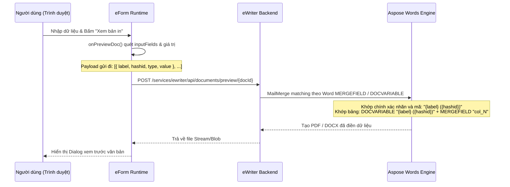

# Sổ tay tích hợp eForm ↔ eWriter (MailMerge & Xem bản in)

> **Tài liệu tham chiếu nhanh (Playbook)** dành cho các session làm việc với hệ thống Kyta Platform.
> Hướng dẫn cách cấu hình, chèn biến, đồng bộ mã `hashid`, cấu hình nút xem bản in và sửa lỗi **"điền xong thông tin -> eWriter không nhận được dữ liệu từ form"**.

---

## 1. Cơ chế cốt lõi: Cách eForm và eWriter liên kết dữ liệu

Khi người dùng mở một eForm, điền thông tin và bấm nút **"Xem bản in"** (component `view_ewriter`):



### Quy tắc khớp biến của eWriter MailMerge
Backend eWriter **KHÔNG** khớp dữ liệu theo `formId` hay `key`, mà khớp theo **CẶP `{ label, hashid }`**:
1. **Trường đơn (Text, Date, Dropdown, Textarea, Number, Signature...)**:
   - Trong file `.docx` mẫu, trường được khai báo dạng Word `MERGEFIELD`:
     `{ MERGEFIELD "Tên nhãn (mã_hashid)" }`
     *Ví dụ:* `{ MERGEFIELD "Công trình (2tojlbka6)" }`
   - Payload gửi từ eForm phải chứa đúng:
     `{ label: "Công trình", hashid: "2tojlbka6", value: "Dự án Landmark 81" }`
2. **Bảng dữ liệu nâng cao (`table_advance`)**:
   - Dòng lặp của bảng trong file `.docx` phải chứa trong ô đầu tiên:
     `{ DOCVARIABLE "Tên bảng (mã_hashid)" }` `{ MERGEFIELD "col_1" }`
   - Các ô tiếp theo chứa:
     `{ MERGEFIELD "col_2" }`, `{ MERGEFIELD "col_3" }`, ..., `{ MERGEFIELD "col_N" }`
   - Payload gửi từ eForm phải là mảng 2 chiều:
     `{ label: "Danh sách dòng hạng mục PR", hashid: "jvpvs9zbt", type: "table_advance", value: [ ["1", "VT01", ...], ["2", "VT02", ...] ] }`

---

## 2. Nguyên nhân gốc rễ lỗi "eWriter không nhận được dữ liệu từ form"

| Hiện tượng | Nguyên nhân |
|---|---|
| Bấm "Xem bản in" file mở ra trắng tinh / biến bị mất giá trị | `hashid` của component trên form **KHÔNG TRÙNG** với mã trong dấu ngoặc đơn của file Word mẫu eWriter. |
| Một form nhận dữ liệu, form khác không nhận | Khi kéo thả form hoặc nhúng subform (`child_form`) vào các bước duyệt khác nhau (Start, TBPSX, CHT, BPCU, Update, Approved), hệ thống sinh ra các `hashid` ngẫu nhiên khác nhau cho cùng một trường. |
| Bảng `table_advance` in ra chuỗi JSON thay vì chia dòng | Dòng bảng trong docx chưa đúng cú pháp `DOCVARIABLE "label (hashid)"` + `MERGEFIELD "col_N"` sạch không chứa rác định dạng Word. |

---

## 3. Checklist 5 bước triển khai chuẩn cho một Luồng mới

Khi làm việc với một luồng mới (ví dụ Luồng 2 BCH, Luồng Hợp đồng, Luồng Thanh toán...):

- [ ] **Bước 1**: Đăng ký biến vào eWriter Document (`save-all` và `template-variables`).
- [ ] **Bước 2**: Chèn biến vào file `.docx` mẫu (`MERGEFIELD "Label (code)"` và `DOCVARIABLE`).
- [ ] **Bước 3**: Thêm nút **"Xem bản in"** (`view_ewriter`) vào các form cần xem trước.
- [ ] **Bước 4**: **Đồng bộ mã `hashid`** trên tất cả các form (Child form + Parent forms) khớp 100% với code trong Word mẫu.
- [ ] **Bước 5**: Chạy script kiểm thử E2E tự động để xác nhận 100% trường dữ liệu merge thành công.

---

## 4. Chi tiết các Script mẫu thực hiện nhanh

### 4.1. Thêm nút "Xem bản in" vào eForm
Nút `view_ewriter` cần có cấu hình chuẩn sau trong `p1.components`:

```javascript
const vwNode = {
  id: `${formId}_view_ewriter-1`,
  code: "",
  type: "view_ewriter",
  label: "Xem bản in",
  value: docId, // ID tài liệu eWriter, vd: "000071mzIofW4a0DRXp"
  hashid: Math.random().toString(36).slice(2, 11).padEnd(9, "0"),
  display: true,
  tooltip: "",
  readonly: false,
  validate: { required: false },
  description: "",
  textPosition: "right",
  previewDocumentConfig: {
    useLabelCustom: true,
    pushHiddenField: false // hoặc true nếu muốn gửi cả field ẩn
  }
};
```
Đồng thời thêm vào `variableArr` của form:
```javascript
form.variableArr.push({
  code: `${formId}_view_ewriter-1`,
  variableName: "Xem bản in",
  variableType: "view_ewriter"
});
```

---

### 4.2. Quản lý trạng thái form (Unlock -> Sửa -> Release)
Để cập nhật định nghĩa form (`PUT /services/eform/api/owner/form`), form phải ở trạng thái chỉnh sửa (`editing`). Nếu form đang release (`statusForm === 2` hoặc `4`):

```javascript
const session = require("./src/core/session");
const http = require("./src/core/http");
const api = require("./src/eform/api");
const formDef = require("./src/eform/formDef");

async function updateAndReleaseForm(sess, formId, mutatorFn) {
  // 1. Chuyển form về trạng thái EDIT
  try {
    await http.request(sess, "DELETE", `/services/eform/api/owner/form/change-status?formId=${formId}`);
    await http.request(sess, "GET", `/services/eform/api/owner/form/change-status-edit?formId=${formId}`);
  } catch (e) {
    // Bỏ qua nếu form vốn đã ở trạng thái draft/edit
  }

  // 2. Lấy định nghĩa form
  const form = await http.request(sess, "GET", `/services/eform/api/owner/form?formId=${formId}`);
  const { def, wasString } = formDef.parseFormDef(form);

  // 3. Thực hiện sửa đổi trên cây components
  mutatorFn(def, form);

  // 4. Lưu lại form
  const payload = formDef.buildOwnerFormPayload(form, def, wasString);
  if (form.jsonFormCondition) payload.jsonFormCondition = form.jsonFormCondition;
  await api.putForm(sess, payload);

  // 5. Phát hành lại form (Release)
  await http.request(sess, "GET", `/services/eform/api/owner/form/change-status?formId=${formId}`);
}
```

---

### 4.3. Script đồng bộ `hashid` hàng loạt trên tất cả các Form của Luồng
Dùng script này để quét và gán lại `hashid` cho đúng với mã code trên Word template:

```javascript
const targetMapping = {
  // key: component suffix (ví dụ: textField-3 ứng với formId_textField-3 hoặc textField-3)
  "textField-3": "2tojlbka6", // Công trình
  "textField-2": "yjkyzjdzh", // Số PR KYTA
  "dropdown-1": "3j6xszkza",  // Loại chứng từ PR
  "dropdown-2": "tzhti1m6c",  // Mã dự án
  "datepicker-1": "ksdd21ze8", // Ngày tạo phiếu
  "textField-4": "gqn2npqk0", // Hạng mục
  "textField-5": "xcbjgkfe4", // Nội dung yêu cầu mua hàng
  "textField-6": "gjbqa4jlj", // 1. Thương hiệu
  "textField-7": "x1rcz6wmr", // 2. Màu sắc
  "textField-8": "u4ooonerd", // 3. Yêu cầu
  "dropdown-3": "subk24fno",  // 1. Nhà cung cấp
  "textField-9": "l8vlfh9q9", // 4. Địa điểm giao hàng
  "textField-10": "3ew7lue44", // 5. Người nhận hàng
  "textField-11": "oh4d04kcl", // 7. Trao đổi kỹ thuật
  "textArea-1": "gcax2m7up",  // 8. Ghi chú
  "table_advance-1": "jvpvs9zbt", // Danh sách dòng hạng mục PR
  "textField-1": "qsisgk0p5"  // Người tạo YCMH
};

const sigMapping = {
  "Trưởng BP sản xuất (Ký xác nhận)": "garxjoouy",
  "Chỉ huy trưởng (Ký xác nhận)": "l87d4wvv2",
  "BP cung ứng (Ký xác nhận)": "wywp3t91e"
};

function applyHashids(def) {
  function walk(n) {
    if (!n) return;
    if (Array.isArray(n)) return n.forEach(walk);
    if (typeof n.id === "string") {
      for (const [key, targetHash] of Object.entries(targetMapping)) {
        if (n.id.endsWith("_" + key) || n.id === key) {
          n.hashid = targetHash;
        }
      }
      if (n.type === "signature" && sigMapping[n.label]) {
        n.hashid = sigMapping[n.label];
      }
    }
    for (const k in n) if (typeof n[k] === "object") walk(n[k]);
  }
  walk(def);
}
```

---

### 4.4. Script Test E2E Preview tự động (Không cần mở UI)
Dùng đoạn code sau để kiểm chứng xem dữ liệu mẫu có được điền chính xác 100% vào tài liệu Word không:

```javascript
const session = require("./src/core/session");
const http = require("./src/core/http");
const { readZipEntry } = require("./src/ewriter/docx");

async function testFormPreview(customer, env, formId, docId, mockValues, expectedSubstrings) {
  const sess = await session.open(customer, env, "eform");
  const form = await http.request(sess, "GET", `/services/eform/api/owner/form?formId=${formId}`);
  const def = JSON.parse(form.jsonForm);

  // Thu thập các input fields giống runtime browser
  const fields = [];
  function collect(n) {
    if (!n) return;
    if (Array.isArray(n)) return n.forEach(collect);
    if (n.id && n.type && !["page", "row", "columns", "h1", "h2", "h3", "splitter", "view_ewriter", "text"].includes(n.type)) {
      fields.push(n);
    }
    for (const k in n) if (typeof n[k] === "object") collect(n[k]);
  }
  collect(def);

  const payload = fields.map(it => ({
    ...it,
    formId: it.id,
    value: mockValues[it.id] ?? ""
  }));

  const ewriterSess = await session.open(customer, env, "ewriter");
  const res = await fetch(`${ewriterSess.host}/services/ewriter/api/documents/preview/${docId}?filePdf=false`, {
    method: "POST",
    headers: { ...ewriterSess.authHeaders, "Content-Type": "application/json" },
    body: JSON.stringify(payload)
  });

  const ab = await res.arrayBuffer();
  const xml = readZipEntry(Buffer.from(ab), "word/document.xml").toString("utf8");

  console.log(`=== KẾT QUẢ KIỂM THỬ MERGE FORM ${formId} ===`);
  let allPass = true;
  for (const exp of expectedSubstrings) {
    const pass = xml.includes(exp);
    if (!pass) allPass = false;
    console.log(`  ${exp.padEnd(35)}: ${pass ? "✓ PASS (Đã merge)" : "✗ FAIL (Thiếu)"}`);
  }
  return allPass;
}
```

---

## 5. Bảng tra cứu mã biến Luồng 1 PR (`000071mzIofW4a0DRXp`)

| STT | Tên hiển thị trên Form | Loại component | Khóa component (`key`) | Mã `hashid` chuẩn |
|---|---|---|---|---|
| 1 | Người tạo YCMH | textField | `textField-1` | `qsisgk0p5` |
| 2 | Số PR KYTA | textField | `textField-2` | `yjkyzjdzh` |
| 3 | Loại chứng từ PR | dropdown | `dropdown-1` | `3j6xszkza` |
| 4 | Mã dự án | dropdown | `dropdown-2` | `tzhti1m6c` |
| 5 | Công trình | textField | `textField-3` | `2tojlbka6` |
| 6 | Ngày tạo phiếu | datepicker | `datepicker-1` | `ksdd21ze8` |
| 7 | Hạng mục | textField | `textField-4` | `gqn2npqk0` |
| 8 | Nội dung yêu cầu mua hàng | textField | `textField-5` | `xcbjgkfe4` |
| 9 | 1. Thương hiệu | textField | `textField-6` | `gjbqa4jlj` |
| 10 | 2. Màu sắc | textField | `textField-7` | `x1rcz6wmr` |
| 11 | 3. Yêu cầu | textField | `textField-8` | `u4ooonerd` |
| 12 | 1. Nhà cung cấp | dropdown | `dropdown-3` | `subk24fno` |
| 13 | 4. Địa điểm giao hàng | textField | `textField-9` | `l8vlfh9q9` |
| 14 | 5. Người nhận hàng | textField | `textField-10` | `3ew7lue44` |
| 15 | 7. Trao đổi kỹ thuật vui lòng liên hệ | textField | `textField-11` | `oh4d04kcl` |
| 16 | 8. Ghi chú | textArea | `textArea-1` | `gcax2m7up` |
| 17 | Danh sách dòng hạng mục PR | table_advance | `table_advance-1` | `jvpvs9zbt` |
| 18 | Trưởng BP sản xuất (Ký xác nhận) | signature | `signature-1` | `garxjoouy` |
| 19 | Chỉ huy trưởng (Ký xác nhận) | signature | `signature-2` | `l87d4wvv2` |
| 20 | BP cung ứng (Ký xác nhận) | signature | `signature-3` | `wywp3t91e` |

---

## 6. Các bẫy kỹ thuật (Pitfalls & Gotchas)

1. **`statusForm` chặn sửa đổi**:
   Khi sửa form qua API, nếu form có `statusForm` là `2` (releasing) hoặc `4` (shared), phải gọi `DELETE /owner/form/change-status` và `GET /owner/form/change-status-edit` trước khi gọi `PUT /owner/form`.
2. **Khôi phục `jsonFormCondition`**:
   Khi gọi `PUT /owner/form`, cần giữ nguyên `form.jsonFormCondition` nếu form đã có điều kiện hiển thị/ẩn chữ ký, tránh việc bị mất dây điều kiện phê duyệt.
3. **Cú pháp bảng nâng cao trong Word**:
   Trong dòng dữ liệu của table Word, ô đầu tiên phải đặt `DOCVARIABLE "Tên bảng (hashid)"` và `MERGEFIELD "col_1"`. Tránh để Word tự chèn thêm các thẻ `«col_1»` tĩnh bên trong `w:t` vì có thể gây xung đột khi Aspose lặp dòng.
4. **Đồng bộ cả file cấu hình local**:
   Sau khi sửa trên server, luôn cập nhật lại `fields.json` và `.meta.json` ở local để khi chạy lệnh `kyta eform status` hoặc `kyta eform push` không bị báo lệch hashid.

---

## 7. Chữ ký không hiện trên bản in → PHẢI import form duyệt (đã xác minh 2026-10-01)

**Triệu chứng:** Các field thường (text/bảng) fill đúng nhưng **chữ ký không hiện** trên bản in eWriter của các form duyệt.

**Nguyên nhân gốc (đã xác minh):** Biến thường dùng field subform (prefix `00007163`) có ở mọi form nên luôn resolve. **Chữ ký là field riêng của từng form duyệt** (`<formDuyệtId>_signature-N`, `code` = hashid chữ ký). Nếu **chưa import form duyệt** vào tài liệu eWriter thì **thiếu biến chữ ký** → không có gì để render.

**Cách khớp:** eWriter bind placeholder docx `«... (hashid)»` ↔ biến theo **`code` = hashid**. Chữ ký ký ở bước nào thì lấy biến signature của **đúng form duyệt bước đó**; giá trị ký mang xuyên luồng nên resolve ở các bước sau.

**Cách sửa (làm trên UI eWriter — xem bên dưới vì sao không dùng API):**
1. Với mỗi tài liệu PR, **import tất cả form duyệt (nơi ký)** của luồng đó vào tài liệu.
2. Kéo từng biến `signature` vào **đúng ô ký** (textbox) trong docx.
3. Gỡ các biến rác từ form/tài liệu không liên quan.
→ Sau khi import đủ form duyệt, **chữ ký hiện đủ** (textbox không phải là vấn đề).

**Mapping người ký → form duyệt → field (BMW sandbox):**
- **PR(SP.02.02):** Trưởng BP SX→TBPSX `signature-1` (garxjoouy) · Trưởng BP Vận hành→TBPVH `signature-2` (l87d4wvv2) · Trưởng BP KTKH→TBPKTVH `signature-3` (kt8d4wvv2) · NV cung ứng→NVCU `signature-4` (wywp3t91e)
- **PR(SP.02.03):** Trưởng phòng ban→TPB `signature-1` (garxjoouy). ~~NV mua sắm→NVMS `signature-2` (l87d4wvv2)~~ — **đã bỏ 2026-10-01** (xoá field ký NVMS khỏi form NVMS + Đã duyệt; cần gỡ block/biến ký NVMS trong docx eWriter SP.02.03 trên UI).
- **PR(SP.02.01.01):** Trưởng BP SX→TBPSX `signature-1` · CHT→CHT `signature-2` · BP cung ứng→NPCU `signature-3`
- **PR(SP.02.01.02):** CHT + Đã duyệt (số người ký theo docx)

**Bẫy — API `variable-data/save-all` KHÔNG ghi được (đã thử, là chủ doc):**
- `delete=true` (full sync) → **HTTP 500** kể cả ghi lại y nguyên dữ liệu gốc (nghi do dữ liệu biến có `code` trùng lặp chặn re-insert).
- `delete=false` thêm biến mới → trả 200 nhưng **không persist** (GET chỉ trả biến có placeholder khớp trong docx).
- Sửa biến đang có → **500**.
→ Phải import/bind qua **UI eWriter**. Tool `kyta ewriter vars apply` cũng **bỏ qua field `signature`** (TYPE_MAP trong `src/ewriter/fields.js` không có `signature`).
